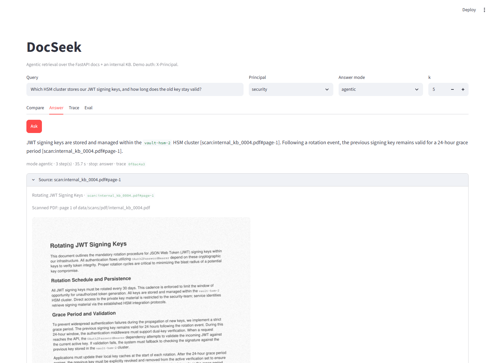
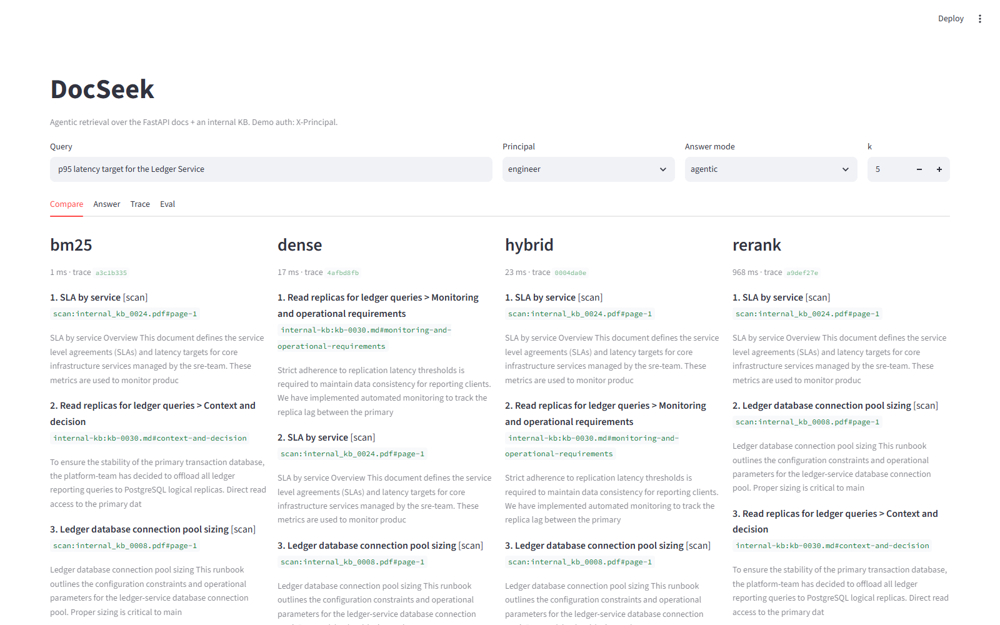
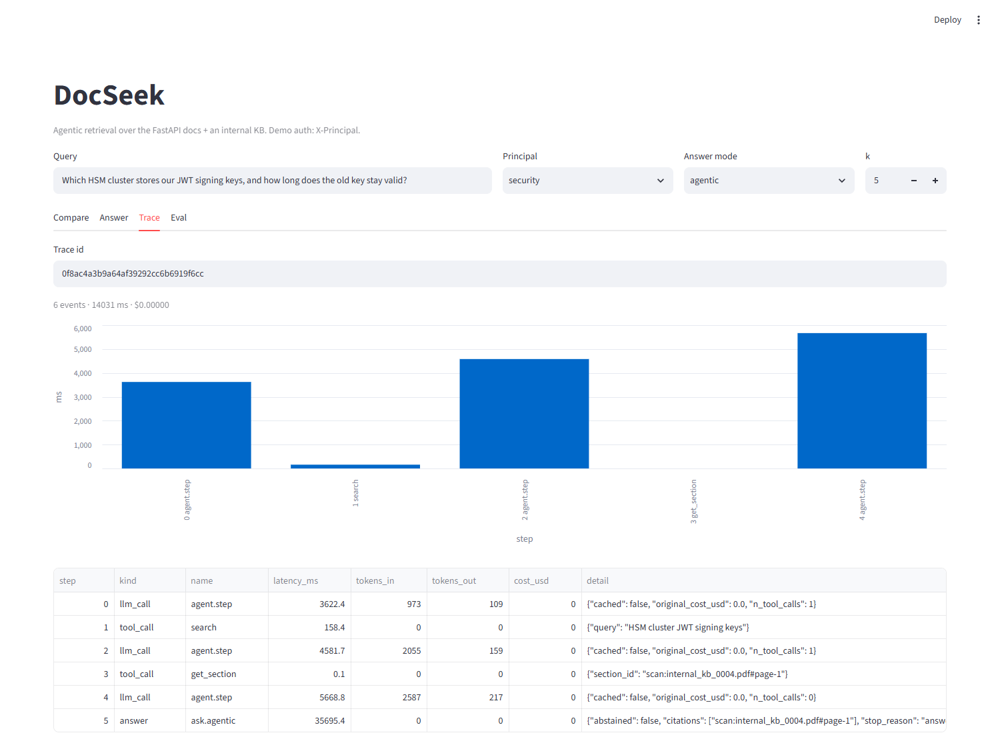
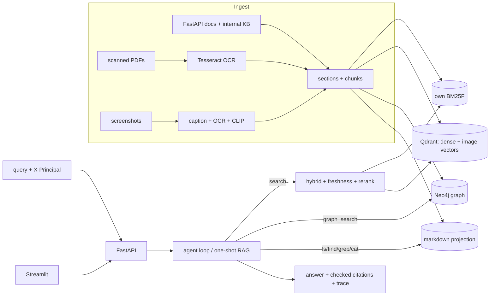

# DocSeek

**Measurable agentic retrieval over technical documentation.** BM25 written from scratch,
dense and hybrid search, cross-encoder reranking, freshness and ACL-aware ranking, a knowledge
graph, sandboxed filesystem tools, OCR'd scans and screenshots, and a tool-calling agent that
cites its sources, all measured on a fixed golden set with confidence intervals.

[](https://github.com/duclld1709/DocSeek/actions/workflows/ci.yml)
 

Corpus: 1,345 sections (FastAPI docs + a synthetic internal engineering KB with ACL and
superseded documents), 46 OCR'd scan pages, 103 screenshots. Golden set: 248 queries
(v1) + 40 scan/image queries, dev/test split, section-level relevance.

> **Labels note.** The golden-set review, the scan/image queries and the judge-calibration
> labels were produced by an AI coding assistant (Claude), not by a person, and are tagged
> `annotator: claude` in the data. See [docs/results/M1.md](docs/results/M1.md).

## Results at a glance

Test split of the final corpus (text + scans + images), 147 answerable queries, from
[`docs/benchmark_report.md`](docs/benchmark_report.md) (run `experiments/20261019T034445Z_bench`).
Latency: warm, 3 passes, laptop with an RTX 3050 (DirectML).

| Pipeline | nDCG@10 [95% CI] | Recall@10 | p95 latency | $ / 1k queries |
|---|---|---|---|---|
| BM25F (own implementation) | 0.693 [0.634, 0.749] | 0.850 | 7 ms | 0 |
| Dense (bge-small, Qdrant) | 0.675 [0.617, 0.735] | 0.830 | 318 ms | 0 |
| Hybrid + freshness (default) | 0.716 [0.663, 0.771] | 0.864 | 120 ms | 0 |
| **+ cross-encoder rerank** | **0.758** [0.703, 0.810] | **0.895** | 1.23 s | 0 |
| + router (query-type rules) | 0.713 [0.660, 0.768] | 0.864 | 109 ms | 0 |
| Agentic (answers, 47 questions) | evidence R@10 **0.915** (one-shot RAG: 0.872) | — | 102 s wall / 53 s compute* | 0 (free tier); ≈ 2.39 at flash-lite prices |

Rerank vs BM25F: +0.065 nDCG@10, p = 0.007 (paired randomisation test). Answer quality
(DeepEval, judge `gpt-5.4-nano`): faithfulness 0.96, answer relevancy 0.92, 13/13 correct
abstentions, 0 hallucinated citations. *The agent runs on a free-tier Gemma endpoint capped at
4 calls/min; "compute" excludes those waits. Leakage@10 = 0 in every run.

## Demo



| Compare retrievers | Trace of one agent run |
|---|---|
|  |  |

## Architecture



- **Ingestion with provenance**: stable section ids, resolved code includes, scan pages with
  `page` provenance, screenshots captioned once by a vision LLM.
- **Retrieval**: BM25F with a code-aware tokenizer, bge-small embeddings in Qdrant, weighted
  min-max fusion, `bge-reranker-base` cross-encoder, superseded-document penalty.
- **Agent**: own tool-calling loop (`max_steps` 6, timeout, per-question budget) over
  `search`, `get_section`, `graph_search`, `image_search`, `ls/find/grep/cat`; citations are
  checked against what was retrieved; abstains with the closest sections otherwise.
- **ACL** enforced in every retriever and tool, principal injected by the server.
- **Evaluation**: section-level relevance, bootstrap CIs, paired randomisation tests, a
  calibrated LLM judge, DeepEval for answers, a CI regression gate.

Details: [docs/architecture.md](docs/architecture.md).

## What makes it production-grade

- **Evaluation methodology**: dev/test split; grids refuse the test split; test runs once per
  final config; numbers in docs come only from `experiments/` run directories.
- **ACL enforcement** in code at the retriever/tool layer (Qdrant filter, lexical pre-mask,
  Cypher `$groups` + post-check, FS hides files as missing, agent principal fixed by the
  server); a probe test for every retriever and tool; Leakage@10 = 0 everywhere.
- **Freshness**: superseded KB documents are penalised after retrieval (StaleHit@5 0.20 → 0.00).
- **Tracing**: every query has a `trace_id`; LLM calls, tool calls and retrieval are traced
  with latency, tokens and cost (`GET /traces/{id}`, private to the caller).
- **Cost control**: one LLM client with a response cache, a per-run `BudgetGuard` and a
  project-wide spend ledger with per-provider caps (OpenAI total for the project: $1.34).
- **CI**: lint + mypy strict, unit tests, a fake-corpus eval gate (fails on regression or
  leakage), integration tests against Qdrant/Neo4j, and a `docker compose up` smoke test.

## Quickstart

Quick demo on the bundled mini corpus (no data download, < 2 min), needs Docker:

```bash
git clone https://github.com/duclld1709/DocSeek.git && cd DocSeek
docker compose up -d --build --wait qdrant api ui     # or: make quick-demo
# UI http://127.0.0.1:8501 · API docs http://127.0.0.1:8000/docs
curl -s -X POST 127.0.0.1:8000/search -H "X-Principal: engineer" \
  -H "Content-Type: application/json" -d '{"query": "BackgroundTasks", "k": 3}'
```

`/search` works out of the box; `/ask` (answers) needs `GEMINI_API_KEY` in `.env`
(`cp .env.example .env`). Auth is simulated with the `X-Principal` header
(`anonymous`, `engineer`, `security`).

### Full pipeline

Requires [uv](https://docs.astral.sh/uv/), Docker, Tesseract, and API keys in `.env`.

```bash
uv sync && docker compose up -d qdrant neo4j
make data      # fetch FastAPI docs, ingest, chunk variants, scans + OCR, image captions, projection
make index     # dense/hybrid indexes, knowledge graph
make serve     # API on :8000 (configs/service.yaml)   and in another shell:  make ui
uv run docseek eval run --config configs/experiments/rerank_fresh_ctx.yaml --split test
uv run docseek bench                                    # benchmark report data
```

Without `make` (Windows), run the commands listed in the [Makefile](Makefile).

## Project structure

```
configs/          corpus pin, principals -> ACL groups, models, experiments/, service.yaml
src/docseek/
  core/           models, stable ids, settings, ACL, tracing
  ingest/         markdown parser, chunking, PDF + OCR, images, scans, projection
  lexical/        tokenizer, inverted index, BM25/BM25F, TF-IDF
  dense/          embedders, Qdrant store, CLIP image retriever
  hybrid/ rerank/ fusion and normalisation, cross-encoder
  query/          classifier, rewrite, filters, freshness, router
  graph/ fs/      Neo4j graph retrieval (templates only), sandboxed FS tools
  agent/          tools, loop, citations, runtime wiring
  api/ ui/        FastAPI, Streamlit
  eval/           golden set, metrics, judges, stats, runner, bench, DeepEval adapter
  llm/            LiteLLM client, cache, budget, spend ledger
scripts/          one-off experiment scripts (OCR bench, answer eval, plots)
tests/            unit/ integration/ fixtures/
docs/             architecture, ADRs, results per milestone, benchmark report
```

## Key engineering decisions

- [ADR 0001: own BM25 implementation](docs/adr/0001-own-bm25.md)
- [ADR 0002: relevance at section level](docs/adr/0002-section-level-relevance.md)
- [ADR 0003: LLM models under a fixed budget](docs/adr/0003-llm-models-under-a-fixed-budget.md)
- [ADR 0004: chunking strategy](docs/adr/0004-chunking-strategy.md)
- [ADR 0005: query understanding on a local model](docs/adr/0005-query-llm-model.md)
- [ADR 0006: Cypher templates only](docs/adr/0006-cypher-templates-only.md)
- [ADR 0007: agent loop and answer evaluation](docs/adr/0007-agent-loop-and-answer-eval.md)

## Benchmark report and failure analysis

[docs/benchmark_report.md](docs/benchmark_report.md): quality by query type, latency
p50/p95/p99, RAM, disk, build time, $/1k queries, int8 quantization and HNSW `ef`
tradeoffs, answer-mode comparison, and failure analysis. Per-milestone results:
[docs/results/](docs/results/). Interview notes: [docs/interview-notes.md](docs/interview-notes.md).

## Roadmap / what I'd do next

- Split scan pages by detected headings so answers that exist only in scans are retrieved as
  well as text (they currently lose ~0.11 nDCG@10).
- A stronger agent model (or few-shot tool-use prompts) so it uses `graph_search` on
  multi-hop questions, the weakest slice (nDCG@10 ≈ 0.43).
- **SPLADE** (learned sparse retrieval) as the lexical child of the hybrid.
- **Docling** as a layout-aware PDF parser for tables and reading order, compared on the
  same CER/WER and table-cell benchmark.
- A cheaper reranker for the default mode, and human review of the assistant-written labels.

## Acknowledgements

- [FastAPI documentation](https://github.com/fastapi/fastapi) (MIT License), the main corpus,
  pinned to commit `b23d78f2ce4e7b3ea48a59f51ca249690d9fd02c`.
- Syllabus reference: the "Production-Grade Agentic RAG" course.
