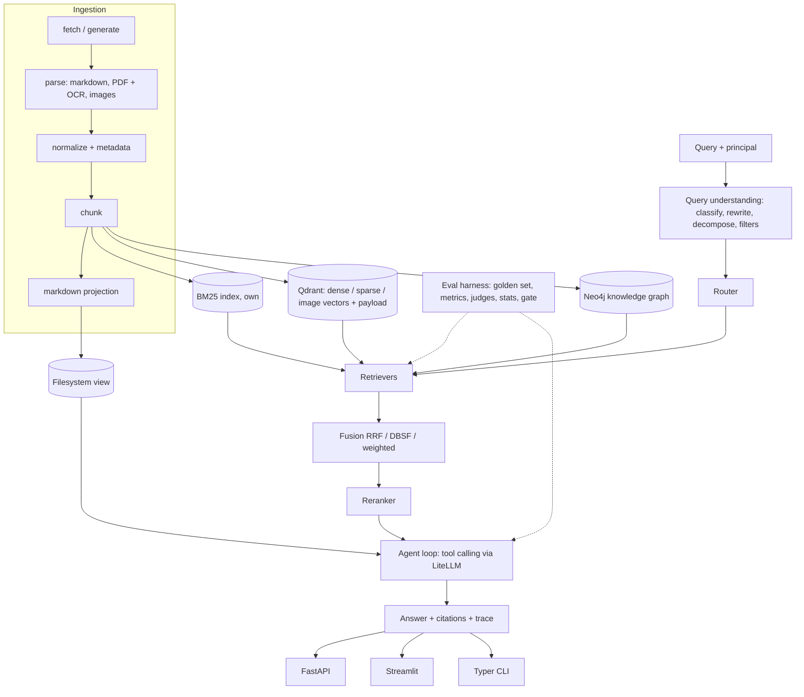
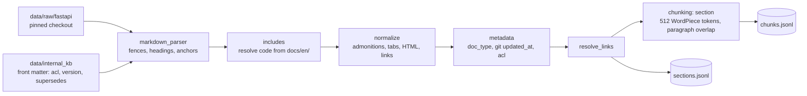

# Architecture (draft)

> Draft written in M0. Sections are filled in as milestones land; the "Status" column says
> what exists today.

## System overview



## Components

| Package | Responsibility | Status |
|---|---|---|
| `core/` | Pydantic models, stable ids, `Protocol` interfaces, settings, structured logging | M0 |
| `testing/` | Deterministic fakes (`HashEmbedder`, `IdentityReranker`, `ScriptedLLM`) | M0 |
| `data/` | `data fetch` (pinned sparse clone + manifest), `data gen-internal` (Corpus B) | M0, M1 |
| `doctor.py`, `cli.py` | Environment checks and CLI entry point | M0 |
| `ingest/` | Markdown parser, code includes, normalisation, metadata, internal KB, chunking, `docseek ingest` | M1 |
| `llm/` | `LiteLLMClient`, `CachedLLMClient`, `BudgetGuard`, `SpendLedger`, rate limiter | M1 |
| `eval/` | Golden set, synthetic queries, review/labelling, judge + calibration, metrics, statistics, runner | M1 |
| `lexical/` | Tokenizer, inverted index, TF-IDF, BM25 | M2 |
| `dense/` | Embedders, Qdrant store | M3 |
| `hybrid/`, `rerank/` | Fusion, normalisation, cross-encoder | M4 |
| `query/` | Classifier, rewrite, decomposition, filters, router | M5 |
| `graph/`, `fs/` | Neo4j graph retrieval, sandboxed filesystem tools | M6 |
| `multimodal/` | OCR, CLIP, captions | M7 |
| `agent/`, `api/`, `ui/` | Agent loop, HTTP API, demo UI | M8 |

## Data units and identifiers

```
Document  doc_id     = "<source>:<relative_path>"        fastapi-docs:tutorial/dependencies/index.md
Section   section_id = "<doc_id>#<anchor>"               ...index.md#first-steps
Chunk     chunk_id   = "<section_id>::<strategy>::<n>"   ...index.md#first-steps::section::0
```

Relevance is labelled per **section**; chunk hits are mapped back to sections (best rank
per section, duplicates dropped) during evaluation, so chunking strategies can be compared
on the same golden set. Helpers live in `docseek.core.ids`.

## Ingestion (M1)



The parser is line-based, not CommonMark, so it keeps exact line numbers for provenance and
understands the mkdocs dialect. Unresolvable constructs become placeholders plus a reported
`ParseIssue`, never raw syntax. `docseek ingest` skips the work when the input hash (corpus
commit, KB files, chunking settings, token counter, ingest code) is unchanged.

## LLM access (M1)

```
caller --> CachedLLMClient --(miss)--> BudgetGuard (per run) --> SpendLedger (per provider,
   |            |                       whole project)          --> LiteLLMClient --> provider
   |            +--(hit)--> response, cost 0          RateLimiter (rpm), model params
   +--> Tracer: one llm_call event per call (tokens, cost actually spent, cached flag)
```

- The cache key is the sha256 of model, messages, tools, temperature, response schema and
  per-model parameters (`reasoning_effort`), so reruns are free and deterministic.
- Structured replies that fail validation are paid for and traced but not cached.
- Model choice and spend limits are in `configs/models.yaml` (ADR 0003).

## Evaluation harness (M1)

- `eval synth` drafts queries per qtype with the generator, filters them (dedup by
  embedding, answerability by the judge), records lexical overlap and judged hard negatives.
- `eval review`, `eval build-golden`, `eval label` and `eval calibrate` are the human steps:
  review, hand-written queries, blind labels, judge-vs-human kappa and bias checks.
- `eval run` evaluates a retriever config on a split; `eval compare` gives paired deltas
  with bootstrap CIs and randomization p-values. Random and Oracle retrievers check the
  harness itself. Relevance is per section (ADR 0002).

## Cross-cutting rules

- **ACL is enforced in retrievers and tools**, from the server-side principal
  (`configs/principals.yaml`). `MetadataFilter` has no ACL field, so a query or an
  LLM-extracted filter cannot widen access. Unknown principals are rejected.
- **Every LLM call** goes through `CachedLLMClient` + `BudgetGuard` (from M1). Model names
  live only in `configs/models.yaml`; the judge must come from a different provider family
  than the generator, which the config loader enforces.
- **Determinism:** fixed seeds; tests use fakes only (no network, no keys).
- **Reproducible data:** the corpus is pinned to a commit and recorded in
  `data/raw/MANIFEST.json` with per-file sha256 (line endings preserved byte-for-byte).
- **Observability:** structlog JSON logs on stderr with secret masking; `trace_id` bound
  through context variables.

## Local services

`docker-compose.yml` runs Qdrant `v1.19.2` and Neo4j `5.26-community`, bound to
`127.0.0.1`, with healthchecks and named volumes. Clients default to `127.0.0.1` rather
than `localhost`, because on Windows `localhost` tries IPv6 first and adds about 2 s to
every new connection.
