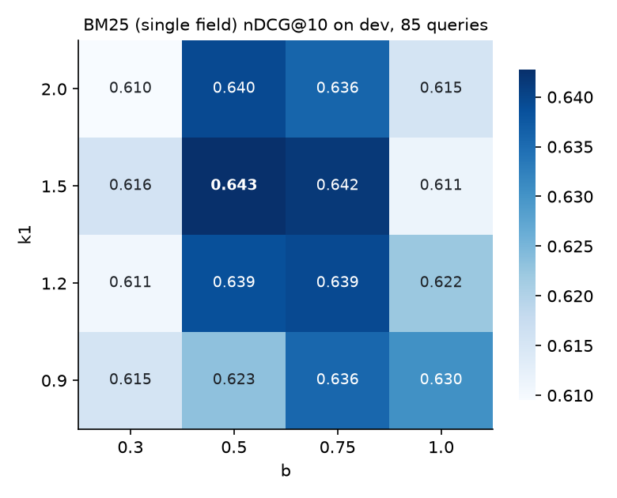

# M2 results: Lexical search (TF-IDF → BM25 → BM25F)

All numbers come from run directories under `experiments/` created on 2026-10-18 (named in
each table). Golden set: `data/golden/golden_v1.jsonl` (248 queries; dev 99, test 149; queries
without relevant sections are excluded from ranking metrics but count for Leakage).
**LLM cost of M2: $0** (no LLM calls).

## Acceptance criteria

| Criterion | Status | Evidence |
|---|---|---|
| Own BM25 score matches a hand-worked example | ✅ | `tests/unit/lexical/test_scoring.py` (BM25, BM25F, TF-IDF, k1/b edge cases) |
| Top-10 of `bm25_own` vs `bm25s` overlap ≥ 0.8 with the same tokenizer | ✅ 1.00 | `20261018T124933Z_m2_lexical_bench/bench.json`: identical top-10 order on 99/99 dev queries; identical metrics (`bm25s_dev` = `bm25_tuned_dev`) |
| Table TF-IDF / BM25 default / tuned / ablations, with CIs, by qtype | ✅ | tables below |
| ADR 0001 | ✅ Accepted | `docs/adr/0001-own-bm25.md` |
| Leakage = 0 for every lexical retriever | ✅ | every run below; `tests/unit/lexical/test_retrievers.py` (probe queries × 3 principals) |

## Test split (149 queries, 117 with relevant sections) — run once per config

Runs: `20261018T125323Z_tfidf_test`, `…125330Z_bm25_default_test`, `…125335Z_bm25_tuned_test`,
`…125341Z_bm25f_test`. Brackets are bootstrap 95% CIs; p is the paired randomization test on
nDCG@10 against `bm25f` (delta in parentheses).

| config | nDCG@10 | Recall@10 | MRR@10 | Hit@1 | Leak | p50 ms | p vs bm25f |
|---|---|---|---|---|---|---|---|
| tfidf | 0.517 [0.451, 0.582] | 0.752 [0.681, 0.823] | 0.456 [0.387, 0.524] | 0.315 [0.236, 0.394] | 0 | 1.4 | 0.000 (-0.126) |
| bm25_default (k1 1.2, b 0.75) | 0.632 [0.560, 0.696] | 0.787 [0.717, 0.850] | 0.595 [0.520, 0.667] | 0.480 [0.394, 0.567] | 0 | 1.7 | 0.525 (-0.011) |
| bm25_tuned (k1 1.5, b 0.5) | 0.634 [0.563, 0.700] | 0.803 [0.736, 0.866] | 0.588 [0.509, 0.660] | 0.472 [0.378, 0.559] | 0 | 1.7 | 0.521 (-0.009) |
| **bm25f** (tuned + field weights) | **0.644** [0.576, 0.707] | **0.831** [0.764, 0.890] | 0.592 [0.518, 0.661] | 0.465 [0.378, 0.543] | 0 | 2.3 | ref |

nDCG@10 by qtype (test):

| config | conceptual (19) | factoid (26) | freshness (10) | howto (35) | multihop (12) | permission (11) | symbol (20) |
|---|---|---|---|---|---|---|---|
| tfidf | 0.536 | 0.628 | 0.598 | 0.431 | 0.249 | 0.773 | 0.564 |
| bm25_default | 0.564 | 0.711 | 0.746 | 0.574 | 0.329 | 0.984 | 0.734 |
| bm25_tuned | 0.584 | 0.714 | 0.682 | 0.570 | 0.359 | 0.984 | 0.746 |
| bm25f | 0.565 | 0.737 | 0.607 | 0.569 | 0.383 | 0.902 | 0.837 |

## Dev split (99 queries, 85 with relevant sections): tuning and ablations

| config | nDCG@10 | Recall@10 | MRR@10 | Leak | p vs bm25f |
|---|---|---|---|---|---|
| tfidf | 0.574 [0.503, 0.655] | 0.818 | 0.516 | 0 | 0.007 (-0.078) |
| bm25_default | 0.639 [0.568, 0.714] | 0.829 | 0.613 | 0 | 0.492 (-0.013) |
| bm25_tuned = **ablation: no field weights** | 0.643 [0.565, 0.721] | 0.841 | 0.612 | 0 | 0.584 (-0.010) |
| **bm25f** (final) | 0.652 [0.579, 0.726] | 0.871 | 0.612 | 0 | ref |
| ablation: no stemming | 0.623 [0.545, 0.698] | 0.841 | 0.577 | 0 | 0.140 (-0.030) |
| ablation: no code-aware tokenization | 0.655 [0.584, 0.730] | 0.871 | 0.613 | 0 | 0.850 (+0.002) |
| bm25s (reference, same tokens as bm25_tuned) | 0.643 | 0.841 | 0.612 | 0 | = bm25_tuned |

- k1 × b grid (single-field BM25): `20261018T124650Z_bm25_default_grid_dev`, plotted below.
  Best k1 = 1.5, b = 0.5 (0.643); the whole grid spans 0.610–0.643.
- Field weights (title ∈ {1,2,3} × code ∈ {0.5,1} × section_path ∈ {0.5,1}, body = 1):
  `20261018T124718Z_bm25f_grid_dev`. Best title 2, section_path 0.5, body 1, code 0.5
  (0.652); code weight 1.0 was worse in all 6 pairs (0.619–0.635).

## Own BM25 vs bm25s (`20261018T124933Z_m2_lexical_bench`, 1,426 chunks, 99 dev queries)

| | own (`bm25`, single field) | bm25s 0.3.13 (Lucene) |
|---|---|---|
| build (incl. tokenization), best of 3 | 0.43 s | 1.79 s |
| index on disk | 1.25 MB (pickle) | 0.66 MB |
| query p50 / p95 | 1.46 / 2.89 ms | 0.68 / 1.51 ms |
| top-10 overlap / identical order | 1.00 / 99 of 99 | |

## Analysis

- **BM25 is the clear step up from TF-IDF** (test nDCG@10 +0.115 for bm25_default; bm25f vs
  tfidf p = 0.000 in the paired randomization test). Tuning k1/b and field weights add little on top: +0.012 nDCG@10 on test,
  not significant (p ≈ 0.52); the k1×b surface is flat (0.61–0.64 on dev).
- **Hypothesis confirmed in part.** BM25F is strongest on `symbol` (0.837) and `factoid`
  (0.737) and weakest on `multihop` (0.383) and `conceptual` (0.565). Field weighting mainly
  helps `symbol` (+0.09 over bm25_tuned): titles carry the API names.
- **Field weighting hurts freshness/permission queries** on test (freshness 0.682 → 0.607,
  permission 0.984 → 0.902, n = 10–11 each, wide CIs). Internal-KB versions share titles, so
  the title boost cannot separate old from new; M5's freshness boost targets this.
- **Stemming matters** (dev −0.030 without it). **Code-aware tokenization shows no measurable
  effect** (+0.002, p = 0.85): CamelCase symbols already survive the plain tokenizer as one
  lower-cased token, and few golden queries use snake_case or `@decorator` forms. It is kept
  because it is not worse and the symbol slice is small.
- **Failure analysis (15 worst dev queries of bm25f, causes assigned by Claude):**
  near-duplicate or sibling sections outrank the labelled one — often same page, sometimes
  equally valid but unlabelled (7: q0036, q0060, q0114, q0131, q0145, q0232, q0238);
  vocabulary mismatch/paraphrase (6: q0016 "standard output format" vs `default_response_class`,
  q0031, q0095, q0123 "UNAUTHORIZED" vs 401, q0144, q0147); query too short / numeric (1:
  q0219 "return 201 instead of 200"); template noise across generated KB postmortems (1:
  q0090, many "Timeline" sections). 11 of the 15 are synthetic paraphrase-style queries.
  Paraphrase failures motivate dense retrieval (M3); the unlabelled near-duplicates motivate
  pooling for golden v2 (M4).
- **Own vs library.** Same scores to float precision; bm25s queries ~2× faster (sparse matrix
  vs our per-term NumPy loop), ours builds ~4× faster and is easier to extend (BM25F, masks).
  At 1.4k chunks both are far below 5 ms per query.
- ACL is a **pre-filter** (mask before top-k): every principal gets up to k readable hits and
  Leakage is 0 on every run. Cost: one boolean mask per principal (cached), O(N) per query.
