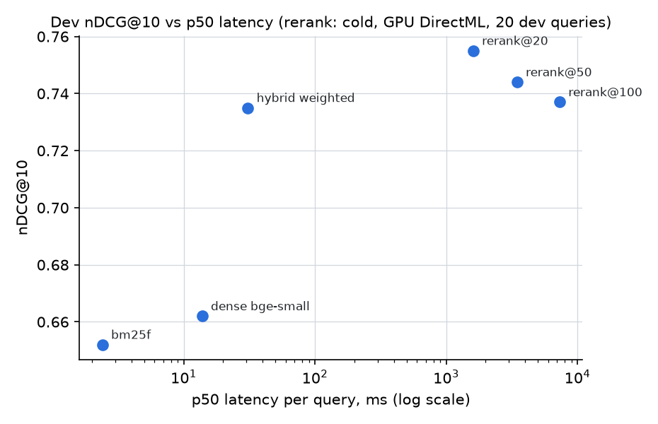

# M4 results: Hybrid retrieval + reranking

All numbers come from run directories under `experiments/` created on 2026-10-18 (named in
each section). Primary labels: `golden_v1` (dev 99 / test 149; 85 / 127 answerable). Golden v2
results are secondary (see below). Fusion children: `bm25f` (M2) and `dense_bge_small` (M3),
each fetched to depth 50 (rerank configs: depth 100).

**Hardware note.** From the rerank grid on, fastembed models run on the laptop GPU (RTX 3050
6 GB) through `onnxruntime-directml` (`DOCSEEK_ONNX_PROVIDERS=auto`). The first 2,400 rerank
scores were computed on CPU before the switch and reused from the score cache. M2/M3 timings
are CPU.

## Acceptance criteria

| Criterion | Status | Evidence |
|---|---|---|
| RRF unit test with a hand-worked example + empty list, duplicate id, tie | ✅ | `tests/unit/hybrid/test_fusion.py` |
| Best hybrid ≥ max(BM25, dense) on test nDCG@10 | ✅ | hybrid 0.709 vs 0.644 / 0.641 (p ≤ 0.001); rerank@20 0.739 |
| Quality–latency chart + recommended default | ✅ | chart and recommendation below |
| `golden_v2.jsonl` with review notes | ✅ (unreviewed) | `data/golden/golden_v2.jsonl`, `pool_judgments_v2.jsonl`; all judge labels `reviewed: false` |
| Leakage = 0 for every new retriever | ✅ | `tests/unit/hybrid/test_hybrid_retrievers.py` (own hybrid ×2, Qdrant hybrid, rerank); every run below |

## Dev: fusion choices (nDCG@10, 85 queries)

| fusion | setting | nDCG@10 | run |
|---|---|---|---|
| own RRF | k = 30 / 60 | 0.720 / 0.718 | `…133906Z_hybrid_rrf_grid_dev` |
| own RRF (extra, after the Qdrant result) | k = 1 / 2 / 10 | 0.727 / 0.734 / 0.728 | `…134018Z_hybrid_rrf_grid_dev` |
| own weighted, min-max | α (bm25) = 0.3 / **0.5** / 0.7 | 0.724 / **0.735** / 0.704 | `…133918Z_hybrid_weighted_grid_dev` |
| Qdrant Query API, prefetch 50+50, RRF | sparse BM25 (single field) + dense | 0.740 | `…133930Z_qdrant_hybrid_rrf_dev` |
| own RRF, single-field BM25 child | k = 2 / 60 | 0.735 / 0.711 | `…133954Z_hybrid_rrf_grid_dev` |

- Qdrant's RRF uses `1 / (rank + 1)` (client constant 2 with 0-based positions), i.e. our
  k = 1. With matching k our RRF lands within 0.006 of Qdrant's; the remaining gap is within
  noise. Small k helps on this set because one list usually has the answer near the top.
- Chosen first stage: **weighted min-max, α = 0.5** (best own fusion on dev).

## Dev: reranking `BAAI/bge-reranker-base` over the weighted hybrid

| N (reranked) | nDCG@10 | Recall@10 | Leak | cold p50 / p95 per query |
|---|---|---|---|---|
| — (hybrid only) | 0.735 | — | 0 | 31 ms / 49 ms (first stage, depth 100) |
| **20** | **0.755** | 0.924 | 0 | 1.60 s / 2.06 s |
| 50 | 0.744 | 0.906 | 0 | 3.46 s / 4.08 s |
| 100 | 0.737 | 0.894 | 0 | 7.30 s / 8.10 s |

Quality: `20261018T142133Z_rerank_bge_grid_dev`. Latency: `20261018T142630Z_m4_rerank_latency`
(20 dev queries, seed 13, score cache off, GPU DirectML, batch 8). Measured CPU throughput
before the switch: ~0.21 s per pair (bge-reranker-base); GPU: ~0.05–0.07 s per pair.

## Test, golden v1 (127 answerable queries) — run once per final config

Runs: `…125341Z_bm25f_test`, `…133514Z_dense_bge_small_test`, `…134221Z_hybrid_weighted_test`,
`…142702Z_rerank_bge20_test`. p: paired randomization test vs `hybrid_weighted` on nDCG@10.

| config | nDCG@10 | Recall@10 | MRR@10 | Hit@1 | Leak | p vs hybrid |
|---|---|---|---|---|---|---|
| bm25f | 0.644 [0.576, 0.707] | 0.831 | 0.592 | 0.465 | 0 | 0.001 (−0.065) |
| dense_bge_small | 0.641 [0.578, 0.697] | 0.823 | 0.606 | 0.480 | 0 | 0.000 (−0.068) |
| **hybrid_weighted** (α 0.5) | 0.709 [0.649, 0.765] | 0.878 | 0.674 | 0.551 | 0 | ref |
| **rerank_bge20** | **0.739** [0.676, 0.793] | **0.902** | **0.701** | **0.591** | 0 | 0.191 (+0.030) |

nDCG@10 by qtype (test, v1):

| config | conceptual (19) | factoid (26) | freshness (10) | howto (35) | multihop (12) | permission (11) | symbol (20) |
|---|---|---|---|---|---|---|---|
| bm25f | 0.565 | 0.737 | 0.607 | 0.569 | 0.383 | 0.902 | 0.837 |
| dense_bge_small | 0.688 | 0.781 | 0.653 | 0.589 | 0.301 | 0.926 | 0.631 |
| hybrid_weighted | 0.742 | 0.808 | 0.663 | 0.658 | 0.435 | 0.926 | 0.770 |
| rerank_bge20 | 0.739 | 0.832 | 0.839 | 0.652 | 0.436 | 1.000 | 0.834 |

## Golden v2 (pooling, §5.3)

- Pool: top-10 sections of bm25f, dense_bge_small, hybrid_weighted and rerank_bge20 on dev and
  test (8 runs). 3,418 unlabelled pairs judged by `openai/gpt-5.4-nano` with the M1 rubric
  (κ vs Claude's labels 0.922, see M1): grade 0 = 1,906, 1 = 1,085, 2 = 427. **1,512 labels**
  added to 211 of 248 queries; v1 labels never overridden; unanswerable queries not pooled.
  Runs: `20261018T134312Z_pool_v2` (first 3 retrievers), `…_pool_v2` re-runs (cache hits +
  355 rerank pairs). **Nobody reviewed these labels** (`reviewed: false`); the 100-pair human
  review is in `USER_TODO.md`.
- First pass pooled only the three first-stage retrievers. Rerank then scored *lower* than
  hybrid on v2 (0.773 vs 0.797) because 226 of its 1,288 test top-10 entries had never been
  judged and counted as non-relevant (hybrid: 0 of 1,286). Adding rerank@20 to the pool fixed
  this pool bias; the table below uses the final v2.

Test, golden v2 (runs `…143545Z_bm25f_v2_test` … `…143629Z_rerank_bge20_v2_test`):

| config | nDCG@10 | Recall@10 | MRR@10 | p vs hybrid |
|---|---|---|---|---|
| bm25f | 0.723 [0.674, 0.767] | 0.683 | 0.877 | 0.000 (−0.054) |
| dense_bge_small | 0.691 [0.654, 0.725] | 0.668 | 0.911 | 0.000 (−0.086) |
| hybrid_weighted | 0.777 [0.739, 0.812] | 0.741 | 0.935 | ref |
| rerank_bge20 | **0.799** [0.769, 0.829] | **0.755** | 0.939 | 0.150 (+0.022) |

- The ranking of systems is the same on v1 and v2. Absolute nDCG and MRR are higher on v2
  (more relevant sections per query, so a top hit is more often "relevant"), Recall@10 is
  lower (the 211 changed queries gain 7.2 relevant sections on average). v2 is the fairer test for `bm25f` on `symbol`
  and `multihop`, where v1 penalised valid neighbouring sections (M2 failure analysis).

## Hard negatives (dev, golden v1 hard negatives, 46 queries)

`scripts/hard_negatives.py`: share of (positive, hard negative) pairs ranked in the right order.

| run | correctly ordered |
|---|---|
| bm25f | 60 / 69 (0.870) |
| hybrid_weighted | 63 / 71 (0.887) |
| rerank@20 | 68 / 69 (0.986) |
| rerank@50 | 68 / 69 (0.986) |

## Analysis and recommendation

- **Fusion is the big win**: +0.065 nDCG@10 over either single retriever on test
  (p ≤ 0.001), and it recovers most of each one's weak slices (conceptual 0.742, symbol
  0.770). Min-max weighted with α = 0.5 and RRF with small k are equivalent within noise.
- **Reranking adds +0.030 on test** (p = 0.19, not significant at n = 127) and is clearly
  better at separating hard negatives (0.986 vs 0.887). Gains concentrate on `freshness`
  (+0.18) and `symbol` (+0.06).
- **More candidates hurt** (N = 20 > 50 > 100 on dev). A likely cause (not verified per
  query) is that the cross-encoder promotes similar but unlabelled or wrong sections from deep
  in the first-stage list; latency grows linearly with N.
- **Recommended default:** `hybrid_weighted` (≈ 10–30 ms per query) for interactive search;
  `rerank_bge20` as the quality mode (≈ 1.6 s per query on this GPU, ~4 s on CPU) where answer
  quality matters more than latency, e.g. as the retrieval step of the agent (M8).
- **LLM cost of M4: $0.743** (OpenAI judge for golden v2: $0.660 + $0.083, from the
  `pool_v2` traces). Project ledger after M4: OpenAI $0.933 of the $2.00 cap.
