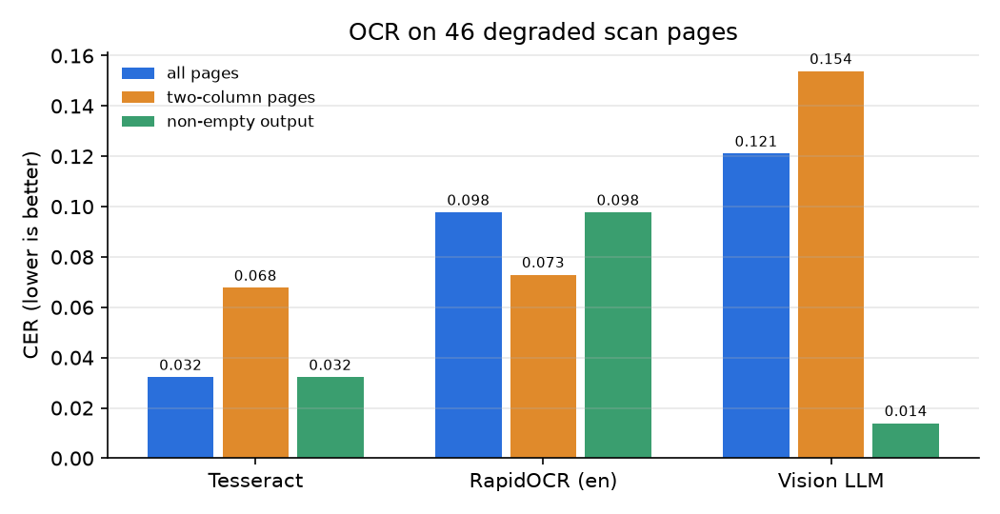

# M7 results: OCR + multimodal

All numbers come from `experiments/` run directories created on 2026-10-18/19 (named below).
Corpus C = 30 image-only PDFs (46 pages: 20 FastAPI docs pages, 10 KB docs; every third doc
in two columns; 150 DPI, rotation, blur, noise, low contrast). Ground truth = the text layer
of the clean render (exactly what was printed). Vision role = `gemini/gemini-3.5-flash-lite`
(free tier; 3.1-flash-lite's 500/day quota was used up). New queries:
`data/golden/golden_multimodal.jsonl`, 20 `scan` + 20 `image` (10 dev / 10 test each), written
by Claude (`origin: claude`, `annotator: claude`, not reviewed by a person).

## Acceptance criteria

| Criterion | Status | Evidence |
|---|---|---|
| OCR table: engine × CER × WER × s/page × $/page × table accuracy | ✅ | table below |
| Image retrieval table, 3 strategies, cost notes | ✅ | table below |
| `scan` and `image` queries in the overall eval, Leakage = 0 | ✅ | `m7_overall_*_test`, Leakage 0 in every run |

## OCR (46 pages)

Runs: `20261018T174943Z_m7_ocr_bench` (Tesseract, RapidOCR), `20261018T180808Z_m7_ocr_bench`
(vision: timing), `20261019T005244Z_m7_ocr_bench` (vision, same cached outputs, adds the
empty-page count). CER/WER after NFKC + whitespace normalisation; table accuracy = cells of
the 4 scanned docs with tables (93 cells; SLA and Error codes tables included).

| Engine | CER | WER | CER 2-col | CER non-empty | s/page | $/page | Table cells |
|---|---|---|---|---|---|---|---|
| Tesseract 5 (`--psm 3`, CPU) | **0.032** | **0.110** | **0.068** | 0.032 | **1.40** | 0 | 0.634 (59/93) |
| RapidOCR + PP-OCRv3 en rec (CPU) | 0.098 | 0.206 | 0.073 | 0.098 | 5.26 | 0 | 0.699 (65/93) |
| Vision LLM (Gemini 3.5 flash-lite) | 0.121 | 0.149 | 0.154 | **0.014** | 5.42 | 0.0013 (list) | **0.817** (76/93) |

- **The vision LLM refused 5 of 46 pages** (empty output, `finish_reason=content_filter`,
  checked with one direct call on `fastapi_tutorial_index` p1): Gemini's recitation filter
  blocks verbatim copies of public text. All 5 are FastAPI docs pages; no KB page was refused.
  An empty page scores CER 1.0, which is why its mean CER is the worst although it is by far
  the best on the pages it does transcribe (0.014).
- **Tables: the vision LLM is best** (0.817 vs 0.699 / 0.634): it returns markdown tables,
  while Tesseract/RapidOCR break multi-line cells. The SLA and Error codes tables were read
  fully by the LLM (1.0 each); one docs table (OpenTelemetry) is weak for every engine (0.29).
- **Two columns**: Tesseract's layout analysis keeps reading order on most pages but one page
  failed badly (CER 0.66, `fastapi_advanced_additional_responses` p2); RapidOCR with our
  midpoint column split is steadier on 2-column pages (0.073) than on 1-column ones (0.109),
  where it drops some long lines.
- Default engine for ingestion: **Tesseract** (best CER, 4× faster, $0, never refuses).

## Scan pages in retrieval

`docseek data scan-chunks`: each scanned page becomes one chunk (`modality=scan`,
`provenance.page`, ACL of the original doc; 46 pages, ACL identical to the originals for all
46). The 135 original sections rendered into the scans are removed from the corpus variant,
so their content exists only as OCR text; golden v1 relevance on them (32 queries) is
remapped to the pages that show them (`golden_v1_scans.jsonl`, derived; v1 untouched).

| Test | nDCG@10 | Recall@10 | MRR@10 | run |
|---|---|---|---|---|
| `scan` queries (10), fresh_ctx on the scan variant | 0.852 | 1.000 | 0.800 | `20261019T010701Z_scan_fresh_ctx_test` |

## Image retrieval (`image` queries; 103 images ≥ 5 KB in 71 sections)

Image chunks = alt text + caption (vision LLM) + Tesseract OCR of the image; CLIP ViT-B/32
(fastembed ONNX) on the `image` named vector. Fusion weight tuned on dev (CLIP α ∈ {0.1 … 0.5},
best 0.3: `20261018T181057Z_img_fusion_w_grid_dev`, `…181115Z…`).

| Strategy | dev nDCG@10 | test nDCG@10 [95% CI] | test R@10 | test run |
|---|---|---|---|---|
| Text corpus only (M5 fresh_ctx, no image info) | 0.402 | 0.386 [0.187, 0.573] | 0.70 | `…010543Z_img_text_only_test` |
| 1. CLIP text → image | 0.356 | 0.393 [0.126, 0.664] | 0.50 | `…010558Z_img_clip_test` |
| 2. Caption + OCR (BM25 + dense on image chunks) | 0.913 | **0.869** [0.735, 0.963] | 1.00 | `…010620Z_img_caption_test` |
| 3. Fusion, CLIP 0.3 + caption 0.7 | **0.963** | 0.825 [0.686, 0.963] | 1.00 | `…010630Z_img_fusion_w_test` |
| fresh_ctx over text + image chunks | 0.863 | **0.876** [0.739, 1.000] | 1.00 | `…010651Z_img_text_captions_test` |

- Caption + OCR beats both the text-only baseline (+0.483, p = 0.008) and CLIP (+0.476,
  p = 0.016) on test (`eval compare`, n = 10).
- CLIP alone is weak: it finds the *kind* of picture (cartoon, Swagger page) but cannot tell
  one Swagger screenshot from another — the distinguishing words are text in the image.
  Equal-weight RRF with CLIP hurt on dev (0.549); a small CLIP weight helped on dev (0.963)
  but not on test (0.825 < 0.869). With 10 queries per split the CIs overlap heavily.
- **Cost**: captions = 103 Gemini calls, list price $0.058 (free tier, not billed; run
  `20261018T175758Z_m7_images`); CLIP and OCR are local and free. Captions are what make image
  retrieval work here; CLIP adds nothing measurable on test.

## Overall eval (golden v1 remapped + scan + image; test 169 queries, 147 answerable)

| Test | nDCG@10 [95% CI] | Recall@10 | image (10) | scan (10) | v1 part (127) | Leak |
|---|---|---|---|---|---|---|
| fresh_ctx on text + image + scan chunks | 0.716 [0.663, 0.771] | 0.864 | 0.913 | 0.852 | 0.689 | 0 |
| router (rules: image → fusion on image chunks) | 0.713 [0.660, 0.768] | 0.864 | 0.876 | 0.852 | 0.689 | 0 |

Runs: `20261019T010714Z_m7_overall_fresh_test`, `20261019T010730Z_m7_overall_router_test`
(paired difference −0.003, p = 1.0). Dev: 0.793 vs 0.802 (`20261018T181203Z…`, `…181215Z…`).

- Rule routing caught 8 of 10 test image queries with no false positives on test (no v1 query
  matched the image or scan rule at all). It does not help, because the single fresh_ctx index
  already ranks the image chunks well when they sit next to the text (0.913).
- **Moving answers into scans costs quality**: the 17 test v1 queries whose relevant sections
  now exist only as scan pages fall from 0.733 (M5, text) to 0.619; the other 110 barely move
  (0.706 → 0.700). Causes: OCR noise, a page holds several sections (coarser unit), and the
  page chunk has no heading path.
- Decision: keep **fresh_ctx over one index with text, image and scan chunks** as the default;
  the router's image/scan routes stay available (config) but are not adopted.
- LLM cost of M7: OpenAI $0; Gemini 149 calls (103 captions $0.058 + 46 OCR pages $0.059,
  list price, from the two runs' traces) ≈ $0.117, free tier, not billed; Ollama not used.

## Harness fix found in M7

Leakage@k took ACLs only from `sections.jsonl`, so scan pages (which exist only as chunks)
counted as leaks (first dev run: 28 "leaks"). It now also uses the ACL carried by their chunks
(`section_acls`, unit-tested); unknown sections still fail closed. All 46 scan-page ACLs were
checked against their original docs before the fix was trusted.
